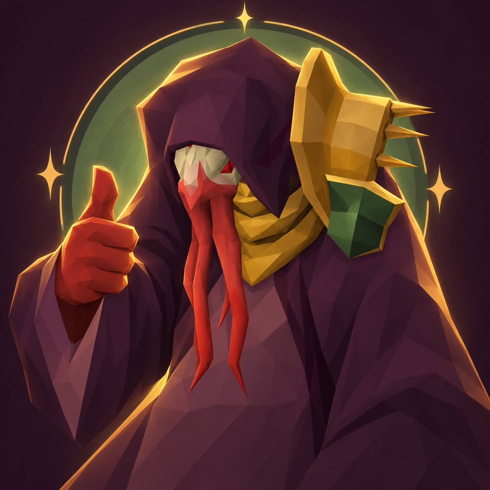

# Positive Ocellus



An independent RuneLite plugin that gives Ocellus in **The Fractured Archive** an encouraging voice. Change each line independently, import your own WAV recordings, and keep your settings across plugin updates.

**Development preview — not yet on the Plugin Hub.** The 19 combat cues have positive scripts and bundled synthetic starter audio. Their sound IDs are deliberately **unmapped (`-1`)** until verified in-game. The plugin will not change game sounds out of the box. There is no claim that all Ocellus audio travels through the currently supported sound events; the capture pass must establish that before release.

## Develop

Java 11 is required. This revision is pinned to RuneLite 1.13.4.

```sh
bash gradlew test build
bash gradlew run
```

Enable **Positive Ocellus** in the development client's plugin list and open its sidebar tab. The development launcher is for testing; copying a JAR into RuneLite is not a supported Plugin Hub installation flow.

## Edit a voice line

1. Select a cue in the sidebar.
2. Set its verified sound ID and event channel (`sound` or `area`). Leave `-1` for unknown IDs.
3. Edit the positive script as a recording note. **Editing text does not synthesize speech.**
4. Import a matching WAV (16-bit signed PCM, mono/stereo, at most 48 kHz and 20 seconds), or use the bundled starter clip.
5. Save and reload, then preview the audio. Each line has its own enable switch.

Data is saved to `~/.runelite/positive-ocellus/voice-pack.json`. Local WAV files in the same folder override bundled clips by filename. Invalid or missing audio leaves the original sound alone. A loaded Ocellus NPC is required for replacement, and game sound/area volume is respected. Preview uses the plugin volume directly. No audio or settings are downloaded at runtime.

Custom files are not overwritten by updates. New default cues can be added with **Add voice line**, or by merging entries from the bundled JSON into your local pack. Keep unique keys and unique enabled channel/ID pairs. The pack is validated and saved atomically; invalid JSON keeps the last working mappings.

## Verify sound mappings

Enable **Capture sound IDs** in plugin settings while fighting Ocellus. The sidebar records nearby sound-event IDs and Ocellus overhead text, capped to avoid unbounded logging. These are **candidates**, including other players and effects, not automatic matches. Copy the text before leaving or closing the client.

Compare repeated occurrences of each cue, test one mapping at a time, and record the game revision and evidence in [the verification checklist](docs/plugin-hub.md). Test that unrelated sounds remain unchanged, delayed sounds retain timing, game mute works, and disabling the plugin restores normal audio. Do not infer an ID from proximity alone. If a line is streamed music rather than a sound event, it needs further implementation; do not assign an unrelated sound ID.

[All 19 combat cues and positive scripts](docs/voice-lines.md).

## Update and release

Change the scripts or audio under `src/main/resources/com/positiveocellus/`, run tests, and commit. The bundled voice pack is a first-run seed, not an automatic overwrite of user settings. Code and bundled asset updates are distributed through reviewed Plugin Hub commits. See [submission instructions](docs/plugin-hub.md).

For the synthetic starter pack only:

```sh
cd tools/speech
npm ci --ignore-scripts
node generate.mjs
```

This uses eSpeak NG via the pinned `espeak-ng` npm package. It is a deliberately basic synthetic voice, not an imitation of the original actor. The build and installed plugin do not depend on Node or eSpeak. Replace the starter clips with recordings you want to release before the final listening review.

## Credits

Ocellus and Old School RuneScape belong to Jagex. This project is unofficial and is not affiliated with Jagex or RuneLite. Combat cue research: [OSRS Wiki transcript](https://oldschool.runescape.wiki/w/Transcript:Ocellus); descriptions in the catalog are paraphrases. No game audio is redistributed.

Artwork was generated with OpenAI ImageGen using the [Ocellus game render](https://oldschool.runescape.wiki/w/File:Ocellus.png) as an identity reference. See [asset provenance and generation prompt](docs/assets.md). Code is BSD-2-Clause; third-party characters and marks remain their owners' property.
